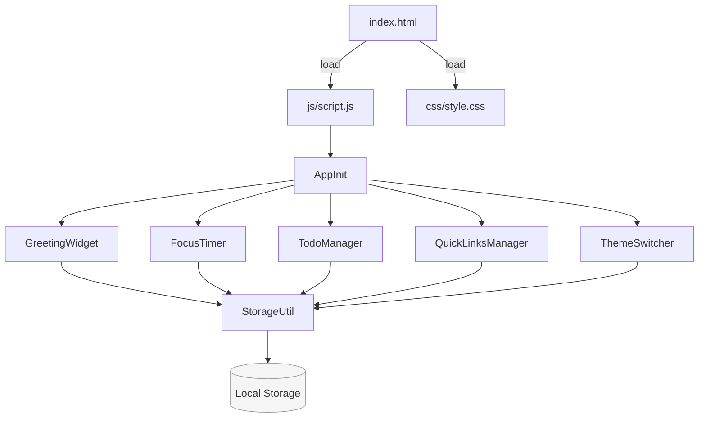

# Design Document

## Overview

To-Do Life Dashboard adalah aplikasi web single-page berbasis browser yang dibangun murni dengan HTML, CSS, dan Vanilla JavaScript tanpa framework. Aplikasi berfungsi sebagai dasbor personal yang menggabungkan empat widget utama: Greeting Widget (jam, tanggal, sapaan personal), Focus Timer (Pomodoro 25 menit), Todo Manager (manajemen daftar tugas), dan QuickLinks Manager (pintasan URL). Semua data pengguna disimpan secara persisten di sisi klien menggunakan Browser Local Storage API. Tampilan dirancang bersih, minimalis, dan responsif dari lebar 320px ke atas.

### Tujuan Desain

- **Kesederhanaan**: Satu file HTML, satu file CSS, satu file JavaScript — tidak ada build step, tidak ada dependensi eksternal.
- **Persistensi lokal**: Semua preferensi dan data pengguna tersimpan di Local Storage tanpa backend.
- **Responsivitas**: Layout menyesuaikan diri dari mobile (satu kolom) ke desktop (dua kolom atau lebih).
- **Aksesibilitas**: Elemen interaktif memiliki label yang tepat dan kontras warna yang memadai.

---

## Architecture

Aplikasi menggunakan arsitektur **Module Pattern** berbasis IIFE (Immediately Invoked Function Expression) di dalam satu file `js/script.js`. Setiap widget diimplementasikan sebagai modul mandiri yang memiliki state sendiri dan berkomunikasi melalui fungsi-fungsi utilitas bersama (seperti `storage` dan `domUtils`).

### Diagram Arsitektur



### Pola Inisialisasi

```
DOMContentLoaded
  └── AppInit.init()
        ├── ThemeSwitcher.init()       ← diterapkan pertama agar tidak ada flash
        ├── GreetingWidget.init()
        ├── FocusTimer.init()
        ├── TodoManager.init()
        └── QuickLinksManager.init()
```

`ThemeSwitcher.init()` dipanggil pertama kali untuk membaca preferensi tema dari Local Storage dan menerapkannya sebelum konten halaman terlihat — mencegah flash of unstyled content (FOUC).

---

## Components and Interfaces

### 1. StorageUtil

Abstraksi tipis di atas `localStorage` dengan penanganan error (try/catch) untuk kasus ketika Local Storage tidak tersedia (misalnya mode private di beberapa browser).

```js
StorageUtil = {
  get(key)           → any | null,   // JSON.parse hasil get
  set(key, value)    → void,          // JSON.stringify sebelum set
  remove(key)        → void,
  isAvailable()      → boolean
}
```

### 2. GreetingWidget

Mengelola tampilan jam real-time, tanggal, sapaan berdasarkan waktu, dan sapaan personal.

**State:**
- `greetingName: string` — nama yang disimpan
- `intervalId: number` — ID dari `setInterval` untuk memperbarui jam

**Interface:**
```js
GreetingWidget = {
  init()              → void,   // memuat nama dari storage, mulai interval
  updateClock()       → void,   // memperbarui tampilan jam + sapaan
  saveName(name)      → void,   // validasi, simpan ke storage
  getTimeGreeting(hour) → string  // pure function: hour → teks sapaan
}
```

**Logika `getTimeGreeting`:**
| Rentang Jam | Teks Sapaan |
|---|---|
| 00:00–11:59 | "Selamat Pagi" |
| 12:00–14:59 | "Selamat Siang" |
| 15:00–17:59 | "Selamat Sore" |
| 18:00–23:59 | "Selamat Malam" |

### 3. FocusTimer

Mengelola hitung mundur 25 menit dengan kontrol start, stop, dan reset.

**State:**
- `timeLeft: number` — detik tersisa (dimulai dari 1500)
- `isRunning: boolean`
- `intervalId: number | null`

**Interface:**
```js
FocusTimer = {
  init()       → void,
  start()      → void,   // memulai setInterval 1 detik
  stop()       → void,   // clearInterval, perbarui UI
  reset()      → void,   // stop + kembalikan timeLeft ke 1500
  tick()       → void,   // kurangi timeLeft, cek 0, perbarui tampilan
  formatTime(seconds) → string  // pure function: number → "MM:SS"
}
```

### 4. TodoManager

Mengelola daftar tugas: tambah, edit, tandai selesai, hapus, validasi duplikat.

**State:**
- `todos: Array<Todo>` — array objek tugas

**Interface:**
```js
TodoManager = {
  init()                     → void,
  loadFromStorage()          → void,
  saveToStorage()            → void,
  addTodo(text)              → { success: boolean, error?: string },
  editTodo(id, newText)      → { success: boolean, error?: string },
  toggleTodo(id)             → void,
  deleteTodo(id)             → void,
  normalize(text)            → string,  // trim + toLowerCase
  isDuplicate(text, excludeId?) → boolean,
  renderList()               → void
}
```

### 5. QuickLinksManager

Mengelola daftar pintasan URL: tambah dan hapus.

**State:**
- `links: Array<QuickLink>` — array objek tautan

**Interface:**
```js
QuickLinksManager = {
  init()                  → void,
  loadFromStorage()       → void,
  saveToStorage()         → void,
  addLink(label, url)     → { success: boolean, error?: string },
  deleteLink(id)          → void,
  validateUrl(url)        → boolean,  // dimulai http:// atau https://
  renderList()            → void
}
```

### 6. ThemeSwitcher

Mengelola tema terang/gelap.

**Interface:**
```js
ThemeSwitcher = {
  init()         → void,   // baca storage, terapkan tema
  toggle()       → void,   // balik tema, simpan ke storage
  applyTheme(theme: 'light' | 'dark') → void
}
```

---

## Data Models

### Todo

```js
/**
 * @typedef {Object} Todo
 * @property {string} id          - Unique ID (timestamp-based, e.g. Date.now().toString())
 * @property {string} text        - Teks deskripsi tugas (maks 200 karakter)
 * @property {boolean} completed  - Status penyelesaian
 * @property {number} createdAt   - Unix timestamp saat dibuat
 */
```

**Contoh:**
```json
{
  "id": "1697694000000",
  "text": "Belajar desain sistem",
  "completed": false,
  "createdAt": 1697694000000
}
```

### QuickLink

```js
/**
 * @typedef {Object} QuickLink
 * @property {string} id      - Unique ID (timestamp-based)
 * @property {string} label   - Teks label yang ditampilkan (maks 50 karakter)
 * @property {string} url     - URL tujuan, harus dimulai dengan http:// atau https://
 * @property {number} createdAt - Unix timestamp saat dibuat
 */
```

**Contoh:**
```json
{
  "id": "1697694001000",
  "label": "GitHub",
  "url": "https://github.com",
  "createdAt": 1697694001000
}
```

### Local Storage Keys

| Key | Tipe | Deskripsi |
|---|---|---|
| `dashboard_greeting_name` | `string` | Nama sapaan pengguna |
| `dashboard_todos` | `Array<Todo>` | Seluruh daftar tugas |
| `dashboard_links` | `Array<QuickLink>` | Seluruh daftar tautan |
| `dashboard_theme` | `"light" \| "dark"` | Preferensi tema |

### Struktur HTML Utama

```html
index.html
├── <head>
│   └── <link rel="stylesheet" href="css/style.css">
├── <body data-theme="light">
│   ├── <header>           ← ThemeSwitcher button
│   ├── <main class="dashboard-grid">
│   │   ├── <section id="greeting-widget">
│   │   ├── <section id="focus-timer">
│   │   ├── <section id="todo-manager">
│   │   └── <section id="quicklinks-manager">
│   └── <script src="js/script.js">
```

### CSS Layout (Responsif)

```css
/* Mobile-first */
.dashboard-grid {
  display: grid;
  grid-template-columns: 1fr;          /* < 768px: 1 kolom */
  gap: 1rem;
  padding: 1rem;
}

@media (min-width: 768px) {
  .dashboard-grid {
    grid-template-columns: repeat(2, 1fr);  /* ≥ 768px: 2 kolom */
  }
}
```

Tema diterapkan via atribut `data-theme` pada `<body>`:
```css
body[data-theme="light"] { --bg: #ffffff; --text: #111111; ... }
body[data-theme="dark"]  { --bg: #1a1a2e; --text: #e0e0e0; ... }
* { transition: background-color 0.3s, color 0.3s; }  /* ≤ 300ms */
```

---

## Correctness Properties

*A property is a characteristic or behavior that should hold true across all valid executions of a system — essentially, a formal statement about what the system should do. Properties serve as the bridge between human-readable specifications and machine-verifiable correctness guarantees.*

### Property 1: Normalisasi tugas mencegah duplikat

*For any* dua string teks tugas yang — setelah di-trim dan dikonversi ke huruf kecil — menghasilkan string yang identik, upaya penambahan tugas kedua SHALL ditolak dan daftar tugas SHALL tidak bertambah panjangnya.

**Validates: Requirements 5.1, 5.2**

### Property 2: Penolakan edit duplikat

*For any* daftar tugas yang berisi setidaknya dua item, jika teks edit suatu tugas — setelah normalisasi — sama dengan tugas lain dalam daftar (bukan tugas yang sedang diedit), maka simpan edit SHALL ditolak dan teks tugas asli SHALL tetap tidak berubah.

**Validates: Requirements 5.3, 5.4**

### Property 3: Toggle completed adalah idempoten ganda (round-trip)

*For any* tugas dengan status `completed` apa pun, melakukan toggle dua kali berturut-turut SHALL mengembalikan tugas ke status `completed` semula — yaitu `toggle(toggle(todo)).completed === todo.completed`.

**Validates: Requirements 4.4, 4.5**

### Property 4: Tugas yang ditambahkan tersimpan di Local Storage

*For any* teks tugas yang valid (non-whitespace, ≤ 200 karakter, tidak duplikat), setelah ditambahkan ke daftar, `StorageUtil.get('dashboard_todos')` SHALL mengandung objek Todo dengan teks yang telah dinormalisasi.

**Validates: Requirements 4.2, 4.10**

### Property 5: Format waktu Focus Timer selalu MM:SS

*For any* nilai detik `s` dalam rentang `[0, 1500]`, `FocusTimer.formatTime(s)` SHALL menghasilkan string dengan format tepat dua digit menit diikuti tanda titik dua diikuti tepat dua digit detik — yaitu cocok dengan pola `/^\d{2}:\d{2}$/`.

**Validates: Requirements 3.1**

### Property 6: Fungsi sapaan mencakup seluruh jam dalam sehari

*For any* bilangan bulat `h` dalam rentang `[0, 23]`, `GreetingWidget.getTimeGreeting(h)` SHALL mengembalikan tepat satu dari empat nilai: "Selamat Pagi", "Selamat Siang", "Selamat Sore", atau "Selamat Malam" — tidak pernah string kosong atau nilai lain.

**Validates: Requirements 1.3, 1.4, 1.5, 1.6**

### Property 7: Validasi URL QuickLinks

*For any* string URL, `QuickLinksManager.validateUrl(url)` SHALL mengembalikan `true` jika dan hanya jika URL dimulai dengan `http://` atau `https://`, dan `false` untuk semua nilai lain (termasuk string kosong, URL relatif, dan protokol lain).

**Validates: Requirements 6.4**

### Property 8: Tautan yang ditambahkan tersimpan di Local Storage

*For any* label dan URL yang valid, setelah tautan ditambahkan ke daftar, `StorageUtil.get('dashboard_links')` SHALL mengandung objek QuickLink dengan label dan URL tersebut, dan total panjang daftar SHALL tidak melebihi 20 entri.

**Validates: Requirements 6.2, 6.5, 6.8**

---

## Error Handling

### Local Storage Tidak Tersedia

`StorageUtil.get()` dan `StorageUtil.set()` membungkus semua operasi dalam try/catch. Jika Local Storage tidak tersedia:
- Semua widget tetap berfungsi secara in-memory selama sesi berlangsung.
- Tidak ada pesan error yang ditampilkan kepada pengguna (sesuai Requirement 2.6, 7.6).
- Data tidak persisten antar-reload halaman.

### Validasi Input

Setiap fungsi `add*` dan `edit*` mengembalikan objek `{ success: boolean, error?: string }`. UI menampilkan pesan error di elemen yang sudah disediakan di dekat input — bukan `alert()`. Pesan error menghilang ketika:
- Pengguna memulai mengetik ulang di input tersebut, atau
- Operasi berikutnya berhasil.

| Kondisi Error | Komponen | Pesan (contoh) |
|---|---|---|
| Input tugas kosong/hanya spasi | TodoManager | "Tugas tidak boleh kosong." |
| Tugas duplikat | TodoManager | "Tugas ini sudah ada dalam daftar." |
| Input label kosong | QuickLinksManager | "Label tidak boleh kosong." |
| URL tidak valid | QuickLinksManager | "URL harus dimulai dengan http:// atau https://." |
| Batas 20 tautan tercapai | QuickLinksManager | "Batas maksimum 20 tautan telah tercapai." |

### Focus Timer Habis

Ketika `timeLeft` mencapai 0, timer berhenti secara otomatis dan menampilkan notifikasi visual (misalnya banner atau badge animasi dalam elemen `#timer-notification`) selama minimal 3 detik, kemudian menghilang secara otomatis.

---

## Testing Strategy

### Pendekatan Pengujian Ganda

Aplikasi ini menggunakan dua lapis pengujian yang saling melengkapi:

1. **Unit tests (example-based)** — memverifikasi perilaku spesifik dengan input konkret.
2. **Property-based tests (PBT)** — memverifikasi properti universal yang harus berlaku untuk semua input yang valid.

### Library yang Direkomendasikan

- **Unit tests**: [Jest](https://jestjs.io/) (atau Vitest untuk lingkungan ESM yang lebih ringan)
- **Property-based tests**: [fast-check](https://fast-check.dev/) — library PBT untuk JavaScript/TypeScript yang matang dan aktif dipelihara

Modul-modul pure function (seperti `StorageUtil`, `getTimeGreeting`, `formatTime`, `normalize`, `isDuplicate`, `validateUrl`) diekstrak agar dapat diuji tanpa DOM.

### Unit Tests (Example-Based)

| Skenario | Modul |
|---|---|
| Tambah tugas valid → panjang daftar bertambah 1 | TodoManager |
| Tambah tugas kosong → ditolak, pesan validasi muncul | TodoManager |
| Edit tugas dengan teks valid → teks diperbarui | TodoManager |
| Edit tugas dengan teks kosong → ditolak, teks asli dipertahankan | TodoManager |
| Hapus tugas → item hilang dari daftar | TodoManager |
| Tambah tautan valid → tautan muncul di daftar | QuickLinksManager |
| Tambah tautan ke-21 → ditolak dengan pesan batas | QuickLinksManager |
| Timer countdown → setelah 1500 tick mencapai 00:00 | FocusTimer |
| Tema toggle → `data-theme` berubah | ThemeSwitcher |
| Reload halaman → data dimuat dari storage mock | Semua widget |

### Property-Based Tests

Setiap property-based test dikonfigurasi dengan **minimum 100 iterasi** dan diberi tag komentar yang merujuk ke properti di design document.

**Format tag:**
```js
// Feature: todo-life-dashboard, Property {N}: {property_text}
```

| Property | Modul yang Diuji | Generator Input |
|---|---|---|
| **Property 1**: Normalisasi mencegah duplikat | `TodoManager.isDuplicate`, `addTodo` | `fc.string()` yang di-trim/lowercase untuk menghasilkan pasangan duplikat |
| **Property 2**: Penolakan edit duplikat | `TodoManager.editTodo` | Daftar tugas acak + teks edit yang sama dengan item lain |
| **Property 3**: Toggle round-trip | `TodoManager.toggleTodo` | `fc.boolean()` untuk status awal, `fc.string()` untuk ID |
| **Property 4**: Tugas tersimpan di storage | `TodoManager.addTodo` | `fc.string({ minLength: 1, maxLength: 200 })` |
| **Property 5**: Format waktu MM:SS | `FocusTimer.formatTime` | `fc.integer({ min: 0, max: 1500 })` |
| **Property 6**: Sapaan mencakup semua jam | `GreetingWidget.getTimeGreeting` | `fc.integer({ min: 0, max: 23 })` |
| **Property 7**: Validasi URL | `QuickLinksManager.validateUrl` | `fc.string()` + `fc.oneof(fc.constant('http://'), fc.constant('https://'))` untuk valid/invalid |
| **Property 8**: Tautan tersimpan di storage | `QuickLinksManager.addLink` | `fc.string()` untuk label + URL valid |

### Contoh Implementasi Property Test

```js
import fc from 'fast-check';
import { getTimeGreeting } from '../js/script.js';

// Feature: todo-life-dashboard, Property 6: Fungsi sapaan mencakup seluruh jam dalam sehari
test('getTimeGreeting mengembalikan salah satu dari 4 sapaan untuk semua jam', () => {
  const validGreetings = ['Selamat Pagi', 'Selamat Siang', 'Selamat Sore', 'Selamat Malam'];
  fc.assert(
    fc.property(fc.integer({ min: 0, max: 23 }), (hour) => {
      const result = getTimeGreeting(hour);
      return validGreetings.includes(result);
    }),
    { numRuns: 100 }
  );
});
```

```js
import fc from 'fast-check';
import { formatTime } from '../js/script.js';

// Feature: todo-life-dashboard, Property 5: Format waktu Focus Timer selalu MM:SS
test('formatTime selalu menghasilkan format MM:SS', () => {
  fc.assert(
    fc.property(fc.integer({ min: 0, max: 1500 }), (seconds) => {
      const result = formatTime(seconds);
      return /^\d{2}:\d{2}$/.test(result);
    }),
    { numRuns: 100 }
  );
});
```

### Integrasi dan Pengujian Manual

Karena aplikasi ini berbasis DOM dan menggunakan Local Storage, beberapa skenario memerlukan pengujian manual atau integrasi dengan jsdom:

- **Responsivitas layout**: Pengujian manual di berbagai ukuran layar (320px, 768px, 1280px) atau menggunakan Playwright/Cypress untuk snapshot visual.
- **Transisi tema ≤ 300ms**: Pengujian manual di browser atau pengukuran dengan Performance API.
- **Notifikasi timer selesai**: Pengujian manual atau end-to-end test.
- **Buka tautan di tab baru**: Pengujian manual (verifikasi `target="_blank"` di HTML).
